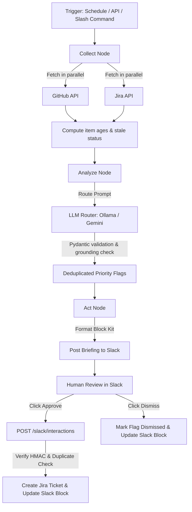

# TeamPulse — AI Operations Agent

> 📖 **Complete Architecture & Flow Guide**: For an exhaustive, step-by-step breakdown of all 6 agents, life of an event, capacity formulas, and LLM fallbacks (ready to paste into Claude, ChatGPT, or Gemini), see [**`PROJECT_ARCHITECTURE_AND_FLOW.md`**](PROJECT_ARCHITECTURE_AND_FLOW.md).

AI operations agent that monitors GitHub pull requests and Jira tickets, detects stale work, automates code review approvals, and provisions hierarchical Jira project plans from natural language.

## 1. Summary

TeamPulse reads open work from GitHub and Jira, identifies items that need attention, delivers formatted briefings to Slack, and facilitates one-click code review approvals and AI project planning.

## 2. What Problem It Solves

Small engineering teams lose track of aging pull requests and stalled Jira tickets.
Reviewers forget open code reviews, and blockers sit unattended across multiple tools.
Every morning, team leads waste time manually checking GitHub tabs and Jira boards.

Example: A developer opens a pull request on Monday. Nobody is assigned to review it. By Thursday, the author has moved to another task, and the code sits untouched. TeamPulse detects that the pull request has had no activity for over 7 days, includes it in the morning Slack briefing, and gives the team lead an "Approve" button to create a Jira triage ticket with one click.

## 3. What It Does

| Feature | What Happens | Where in the Code |
| :--- | :--- | :--- |
| Collect GitHub PRs | Fetches open pull requests and computes age and days since last commit | [app/integrations/github_client.py](app/integrations/github_client.py) |
| Collect Jira tickets | Fetches open issues and computes days since last update and comment counts | [app/integrations/jira_client.py](app/integrations/jira_client.py) |
| Stale item detection | Flags pull requests older than `STALE_PR_DAYS` (default 7) and tickets older than `STALE_TICKET_DAYS` (default 14) | [app/graph/pipeline.py](app/graph/pipeline.py) |
| LLM analysis & fallback | Classifies priority and suggests actions using Gemini or Ollama; falls back to rule-based summary if models fail or return invalid JSON | [app/llm/router.py](app/llm/router.py), [app/llm/schemas.py](app/llm/schemas.py) |
| Grounding check | Verifies all LLM-flagged IDs exist in collected data; blocks invented items and grounds facts to real data | [app/graph/pipeline.py](app/graph/pipeline.py) |
| Slack briefing | Builds Slack Block Kit layout with date header, totals line, categorized priority flags, and Approve / Dismiss buttons | [app/agents/briefing.py](app/agents/briefing.py) |
| Human approval | Write actions are never automatic; clicking "Approve" in Slack executes the action, clicking "Dismiss" marks it dismissed | [app/api/routes/slack.py](app/api/routes/slack.py), [app/agents/actions.py](app/agents/actions.py) |
| Jira ticket creation | On approval, creates a Jira issue with summary "Triage stale PR <id>"; checks for duplicates first | [app/agents/actions.py](app/agents/actions.py) |
| Natural language query | Answers operational questions (e.g. rank by age, count by author, item lookup) over 100% of collected data; governed by `QUERY_LLM_REPHRASE` (default returns code-built template) | [app/agents/query.py](app/agents/query.py), [app/api/routes/briefing.py](app/api/routes/briefing.py) |
| Scheduled jobs | Runs automated briefings at configured morning and evening times using APScheduler | [app/scheduler/jobs.py](app/scheduler/jobs.py) |
| Audit logging | Saves all runs, flags, and actions into database tables with exact status words (`dry_run`, `executed`, `skipped_duplicate`, `dismissed`, `failed`, `refused`) | [app/db/models.py](app/db/models.py) |
| Dry-run mode | When `DRY_RUN_ACTIONS=true`, logs proposed write operations without creating real Jira issues or posting modifications | [app/config.py](app/config.py), [app/agents/actions.py](app/agents/actions.py) |
| AI Project Planner | Deconstructs natural language project ideas into Epics, Tasks, and Subtasks; scales hours proportionally to capacity (capacity allocations, not empirical estimates); automatically provisions Jira hierarchy | [app/agents/planner.py](app/agents/planner.py), [app/api/routes/planner.py](app/api/routes/planner.py) |
| PR Completion Slack Alert | Webhook or alert when PR opens -> extracts Jira key, links Jira ticket in Slack, provides [Approve & Merge] / [Decline] buttons | [app/agents/pr_alert.py](app/agents/pr_alert.py), [app/api/routes/github.py](app/api/routes/github.py) |
| One-Click Slack Auto-Merge | Clicking [Approve & Merge] runs 5 checks before the merge (approver list, dry-run mode, PR state, conflicts, CI), then a post-merge step: merges the PR to main via GitHub REST API, transitions the linked Jira ticket to Done, and records `jira_auto_done` | [app/agents/pr_alert.py](app/agents/pr_alert.py), [app/integrations/jira_client.py](app/integrations/jira_client.py) |
| Jira Done Task Auto-Poller | 15s poller detects tasks moved to Done in Jira, resolves GitHub PR search URL, posts review card to Slack with direct diff link and [Approve & Verify] / [Decline & Reopen] buttons; skips tickets TeamPulse moved itself and remembers alerted tickets across restarts | [app/api/routes/jira.py](app/api/routes/jira.py), [app/api/routes/slack.py](app/api/routes/slack.py) |

## 4. How the Flow Works



### Step-by-Step Description
1. **Trigger**: The pipeline starts from a scheduled cron job (APScheduler), a manual CLI call (`scripts/post_briefing.py`), an API request (`POST /briefing/trigger`), or a Slack command (`/teampulse brief`).
2. **Collect**: GitHub pull requests and Jira issues are fetched concurrently using `asyncio.gather`. Each item gets an age in days and a stale flag. If a source fails, it is marked unavailable and collection continues.
3. **Analyze**: The LLM analyzes the items, filters items flagged within the last 24 hours, and returns structured flags. All output is validated with Pydantic schemas. If the model fails, the system switches to deterministic rule-based analysis.
4. **Grounding**: Before flags reach the briefing, the system verifies that every item ID exists in the real fetched data. Hallucinated IDs are dropped, and evidence fields (author, age) are replaced with real data.
5. **Act**: The system builds a Slack Block Kit message. If all data sources succeeded and no stale items exist, it outputs an "All clear!" message. If a source failed, it places a clear warning banner at the top.
6. **Slack Delivery & Persistence**: Flags are saved to the database in `pending` status *before* posting so their generated database IDs can be bound into Slack button action values (`value=str(flag.id)`). Then the briefing is posted to Slack, and the message timestamp (`slack_ts`) is committed.
7. **Human Approval**: The message displays "Approve" and "Dismiss" buttons. When a user clicks "Approve", Slack sends an HMAC-signed interaction to `POST /slack/interactions`.
8. **Execution**: The server validates the signature, checks for existing duplicate tickets in Jira, executes the action, logs an audit entry to `actions_taken` (`dry_run`, `executed`, `skipped_duplicate`, `dismissed`, `failed`, or `refused`), and updates the Slack block with the resolution.

## 5. Project Structure

```text
teampulse/
├── app/
│   ├── agents/
│   │   ├── actions.py       # Executes approved Slack actions and duplicate prevention
│   │   ├── briefing.py      # Builds Slack Block Kit layout, warnings, and formatting
│   │   ├── planner.py       # AI Project Planner & Jira issue hierarchy creator
│   │   ├── pr_alert.py      # PR completion alert, Jira linking & merge/decline
│   │   └── query.py         # Handles natural language queries, ranking, and counts
│   ├── api/
│   │  │       └── routes/
│           ├── briefing.py  # Routes for manual trigger, run history, and /query
│           ├── github.py    # Route for GitHub webhooks, manual PR alerts, and auto-merge
│           ├── jira.py      # Route for Jira task completion alerts, background poller, and webhooks
│           ├── planner.py   # Routes for AI project planning (/project/plan, /project/provision)
│           └── slack.py     # Routes for Slack interactions (/slack/interactions) and /teampulse commands
│   ├── core/
│   │   ├── constants.py     # Shared constants (urgency levels, status strings)
│   │   ├── errors.py        # Exception hierarchy and single-line log error formatter
│   │   ├── ids.py           # Canonical ID parsing and grounding validators
│   │   ├── rate_limiter.py  # Rate limiter utilities for API requests
│   │   ├── retry.py         # Async retry with exponential backoff and jitter
│   │   └── security.py      # HMAC-SHA256 Slack signature and timestamp verification
│   ├── db/
│   │   ├── database.py      # SQLAlchemy 2.0 engine and session factory
│   │   └── models.py        # Database models (workspaces, agent_runs, flags, actions_taken)
│   ├── graph/
│   │   ├── pipeline.py      # LangGraph 3-node state machine (Collect, Analyze, Act)
│   │   ├── runner.py        # Workspace execution lock and background task runner
│   │   └── state.py         # TeamPulseState Pydantic model for graph state
│   ├── integrations/
│   │   ├── github_client.py # Async GitHub client (pull requests, commits, rate limits)
│   │   ├── jira_client.py   # Async Jira client (issues, JQL search, issue creation)
│   │   └── slack_client.py  # Async Slack client (post message, update block, ephemeral)
│   ├── llm/
│   │   ├── gemini_client.py # Google Gemini API client
│   │   ├── ollama_client.py # Local Ollama REST client
│   │   ├── router.py        # Multi-provider router with fallback and quota tracking
│   │   └── schemas.py       # Pydantic schemas for analysis and structured outputs
│   ├── scheduler/
│   │   └── jobs.py          # Background APScheduler morning and evening cron jobs
│   └── config.py            # Central settings loaded from environment variables
├── evals/
│   ├── fixtures.py          # Deterministic 88-PR and 3-Jira synthetic datasets
│   ├── labeled_cases.json   # 48 labeled evaluation test cases across 9 categories
│   ├── REPORT.md            # Generated accuracy and latency evaluation report
│   └── run_eval.py          # Offline deterministic evaluation runner script
├── scripts/
│   ├── check_stale_prs.py   # CLI script to inspect stale GitHub PRs directly
│   ├── check_stale_tickets.py# CLI script to inspect stale Jira tickets directly
│   ├── eval_live_snapshot.py# CLI script to snapshot real data for local testing
│   ├── post_briefing.py     # CLI script to execute full pipeline and send to Slack
│   ├── reset_db.py          # Development utility to drop and recreate database tables
│   ├── run_graph.py         # CLI script to execute the LangGraph pipeline locally
│   └── show_metrics.py      # CLI script to print database run and action statistics
├── tests/                   # 222 pytest unit tests covering all components
├── PROJECT_SPEC.md          # Technical project specification
└── requirements.txt         # Pinned Python dependencies
```

| Folder or File | What Is Inside | When a Developer Edits It |
| :--- | :--- | :--- |
| `app/agents/` | Briefing formatting, Slack action execution, query answering, planning, PR alerts | To change Slack message layouts, add new action types, or tune query rules |
| `app/api/` | FastAPI routes for Slack interactions, GitHub/Jira webhooks, planner, and briefing | To add new HTTP endpoints or change webhook handling |
| `app/core/` | Security, error definitions, retries, and ID validators | To modify HMAC signature checking, retry delays, or custom errors |
| `app/db/` | Database tables and connection lifecycle | To add new database tables or migrate existing columns |
| `app/graph/` | LangGraph nodes and execution pipeline | To add pipeline steps or change how items are analyzed |
| `app/integrations/` | External API clients for GitHub, Jira, and Slack | To support new GitHub/Jira fields or update API versions |
| `app/llm/` | Model routing, Gemini and Ollama clients, Pydantic schemas | To adjust prompts, add new LLM providers, or change schemas |
| `app/scheduler/` | APScheduler setup and cron triggers | To adjust briefing schedules or add recurring background tasks |
| `app/config.py` | Pydantic configuration settings | To introduce new environment variables or change default values |
| `evals/` | Labeled cases, synthetic datasets, and eval runner | To add regression test cases for operations or evaluation metrics |
| `scripts/` | Standalone CLI tools for debugging and manual execution | To create helper commands or inspect data locally |
| `tests/` | Pytest suite with mocks for external services | To add unit tests for new features or bug fixes |

## 6. Design Decisions

| Decision | Why |
| :--- | :--- |
| Router with fallback | Protects against model outages and rate limits. Tries primary candidates (Gemini or Ollama), falls back to secondary candidates, and falls back to deterministic rules if all models fail. |
| Grounding check | Prevents hallucinated pull request numbers or Jira keys from ever appearing in Slack briefings. Only verified items from real data survive. |
| Code computes, LLM phrases | LLMs can make arithmetic errors when counting or sorting large lists. Python code handles 100% of ranking, counting, and filtering. Governed by `QUERY_LLM_REPHRASE` (default false: code-built template returned directly with zero hallucination). |
| Human approval required | An automated agent should not modify project boards or create tickets without oversight. Suggested write actions require an explicit button click by an authorized user in Slack. |
| HMAC signature verification | Slack webhooks must be verified using HMAC-SHA256 and a 5-minute timestamp window to ensure requests genuinely come from Slack and cannot be replayed. |
| Duplicate ticket check | Before creating a Jira ticket for a stale PR, the agent searches Jira for existing tickets containing the canonical ID, preventing duplicate spam. |
| Flag persistence before Slack post | Flags are flushed to the database in `pending` status first so their auto-generated database IDs can be bound into Slack interactive button action values (`value=str(flag.id)`). Then the Block Kit briefing is posted, and the message timestamp is committed. |
| Failed source shows WARNING, not All clear | A failed GitHub or Jira connection must never be masked as "zero issues". If collection fails, the briefing displays a prominent warning banner and marks counts as `unknown`. |
| Merge safety guardrails | PR merges require 5 checks before the merge (approver list, dry-run mode, PR state, conflicts, CI), then a post-merge step. If no approvers are configured, merge actions are strictly refused. |
| Poller deduplication & restart persistence | Tickets moved to Done by TeamPulse auto-merge or marked verified are recorded in `actions_taken` (`jira_auto_done`, `jira_task_verified`) so the 15-second background poller never re-alerts on actions TeamPulse performed itself. Alerted tickets are permanently stored as `jira_task_alerted` to survive server restarts. |
| Planner capacity scaling | Hours assigned to Epics, Tasks, and Subtasks are capacity allocations scaled proportionally to match total developer capacity ($Devs \times Weeks \times 40h$), rather than empirical work estimates. |

## 7. Tech Stack

| Tool | Used For |
| :--- | :--- |
| Python 3.14 | Programming language runtime |
| FastAPI | Web framework for Slack interaction webhooks and HTTP endpoints |
| Uvicorn | ASGI server running the FastAPI application |
| LangGraph | State machine managing the 3-node pipeline (Collect -> Analyze -> Act) |
| Pydantic v2 | Data validation and structured schema enforcement |
| SQLAlchemy 2.0 | Database ORM supporting MySQL for development and SQLite for tests |
| PyMySQL | MySQL database driver for Python |
| HTTPX | Asynchronous HTTP client for Jira, Slack, Ollama, and webhooks |
| PyGithub | Client library for GitHub REST API interaction |
| APScheduler | In-process background scheduler for morning and evening briefings |
| Google GenAI SDK | Client SDK for Google Gemini models |
| Pytest & Pytest-Asyncio | Testing framework for running the 222 automated unit tests |

## 8. Setup for a Beginner

### Prerequisites
- Python 3.11 or newer (Python 3.14 used in development).
- MySQL Server installed locally (or access to a remote MySQL instance).
- Git installed on your system.
- Access tokens for GitHub, Jira Cloud, and Slack (for live operation).

### Step 1: Clone the Repository
```bash
git clone https://github.com/mnithinn24/teampulse-ai-ops-agent.git
cd teampulse-ai-ops-agent
```

### Step 2: Create and Activate Virtual Environment
On Windows (PowerShell):
```powershell
python -m venv .venv
.\.venv\Scripts\Activate.ps1
```

On Linux or macOS:
```bash
python3 -m venv .venv
source .venv/bin/activate
```

### Step 3: Install Dependencies
```bash
pip install -r requirements.txt
```

### Step 4: Configure Environment Variables
Copy `.env.example` to `.env`:
```bash
cp .env.example .env
```

Open `.env` in your text editor and fill in your settings.

> 💡 **Important Safety Tip for First Run**: Always set `DRY_RUN_ACTIONS=true` for your first run! When true, TeamPulse simulates all write operations across GitHub and Jira and records them with status `dry_run` without altering your real boards or repositories.

### Configuration Settings Reference

| Setting Name | Meaning |
| :--- | :--- |
| `GITHUB_TOKEN` | Personal access token for reading GitHub pull requests and commits |
| `GITHUB_REPOS` | Comma-separated list of GitHub repositories in `owner/repo` format |
| `GITHUB_WEBHOOK_SECRET` | Secret key for verifying HMAC-SHA256 signatures on incoming GitHub webhooks |
| `JIRA_BASE_URL` | Base URL of your Atlassian Jira instance |
| `JIRA_EMAIL` | Account email associated with the Jira API token |
| `JIRA_API_TOKEN` | API token generated from your Atlassian account |
| `JIRA_PROJECT_KEY` | Project key in Jira where issues are tracked and created |
| `JIRA_WEBHOOK_SECRET` | Secret token for verifying incoming Atlassian Jira Cloud webhooks |
| `JIRA_REOPEN_TRANSITION_ID` | Jira workflow transition ID to reopen declined tasks back to In Progress (default 21) |
| `SLACK_BOT_TOKEN` | Bot user OAuth token starting with `xoxb-` |
| `SLACK_SIGNING_SECRET` | Slack app signing secret used to verify request HMAC signatures |
| `SLACK_CHANNEL_ID` | Channel ID where TeamPulse posts the daily briefing |
| `SLACK_APPROVER_IDS` | Comma-separated list of Slack user IDs allowed to approve actions and merge PRs (empty list strictly refuses merge actions for safety) |
| `MAX_FLAGS_IN_BRIEFING` | Maximum number of priority items displayed in one Slack briefing |
| `DRY_RUN_ACTIONS` | Safety switch: set to true to test without creating real Jira tickets or merging code |
| `GEMINI_API_KEY` | API key for Google Gemini LLM access |
| `GEMINI_MODEL` | Primary Gemini model name (e.g. `gemini-3.6-flash`) |
| `GEMINI_FALLBACK_MODEL` | Fallback Gemini model name if the primary model is unavailable (`gemini-3.5-flash-lite`) |
| `GEMINI_THINKING_LEVEL` | Thinking budget level for Gemini models (`low` or `normal`) |
| `OLLAMA_BASE_URL` | URL of local Ollama server (e.g. `http://localhost:11434`) |
| `OLLAMA_MODEL` | Model name to invoke in local Ollama |
| `OLLAMA_ENABLED` | Set to true to allow local Ollama model routing (set to false if not running Ollama) |
| `LLM_TIMEOUT_SECONDS` | Network timeout in seconds for LLM API calls |
| `STALE_PR_DAYS` | Inactivity threshold in days to flag a pull request as stale (default 7) |
| `STALE_TICKET_DAYS` | Inactivity threshold in days to flag a Jira ticket as stale (default 14) |
| `ABANDONED_PR_DAYS` | Threshold in days to classify an aging pull request as abandoned |
| `MAX_ITEMS_IN_PROMPT` | Maximum number of items sent in a single prompt to an LLM |
| `MAX_COMMIT_LOOKUPS` | Cap on individual commit lookups to prevent GitHub rate limit exhaustion |
| `DATABASE_URL` | SQLAlchemy connection URL for MySQL (`mysql+pymysql://...`) |
| `TIMEZONE` | IANA timezone string for briefing dates and rate limit display |
| `ENABLE_SCHEDULER` | Set to true to start the background briefing scheduler |
| `MORNING_BRIEFING_TIME` | 24-hour time string (`HH:MM`) for morning briefing run |
| `EVENING_BRIEFING_TIME` | 24-hour time string (`HH:MM`) for evening briefing run |
| `ADMIN_API_KEY` | Secret token required in `X-API-Key` header for protected API routes |
| `QUERY_RATE_LIMIT_PER_MINUTE` | Max queries per minute permitted per API key on the `/query` endpoint |
| `QUERY_CACHE_TTL_SECONDS` | Cache duration in seconds for collected PRs and tickets |
| `QUERY_LLM_REPHRASE` | Set to true to let LLM rephrase query answers; false returns code-built answers |

### Step 5: Create the Database
Log into MySQL and create the database schema:
```sql
CREATE DATABASE teampulse CHARACTER SET utf8mb4 COLLATE utf8mb4_unicode_ci;
```

Update `DATABASE_URL` in `.env`:
```text
DATABASE_URL=mysql+pymysql://<user>:<password>@localhost:3306/teampulse
```

### Step 6: Initialize Database Tables
Run the database reset script to create all tables:
```bash
python scripts/reset_db.py --yes
```
Expected output:
```text
Resetting database at 'mysql+pymysql://<user>:***@localhost:3306/teampulse'...
Database tables successfully dropped and recreated.
```

## 9. How to Run

### 1. Start the API Server
Run the FastAPI development server:
```bash
uvicorn app.api.main:app --host 0.0.0.0 --port 8000
```
Expected output:
```text
INFO:     Started server process
INFO:     Waiting for application startup.
INFO:     Initializing TeamPulse database schema on startup...
INFO:     Application startup complete.
INFO:     Uvicorn running on http://0.0.0.0:8000 (Press CTRL+C to quit)
```

Verify that the server is alive:
```bash
curl http://localhost:8000/health
```
Expected response:
```json
{"status":"ok","app":"TeamPulse","scheduler_status":"disabled","last_run_time":null}
```

### 2. Expose Local Server for Slack (ngrok)
Slack requires a public HTTPS URL to deliver button clicks and slash commands.
In a new terminal, run:
```bash
ngrok http 8000
```
Copy the `https://<unique-id>.ngrok-free.app` URL.

In your Slack App Settings:
- Under **Interactivity & Shortcuts**, set **Request URL** to:
  `https://<unique-id>.ngrok-free.app/slack/interactions`
- Under **Slash Commands**, set the Request URL for `/teampulse` to:
  `https://<unique-id>.ngrok-free.app/slack/commands`

### 3. Run On-Demand Briefing via CLI
To test the pipeline and post a briefing directly to your Slack channel:
```bash
python scripts/post_briefing.py
```
Expected output:
```text
============================================================
 TeamPulse Ops Briefing Runner (Phase 4)
============================================================
Workspace: default
Run Type : ondemand
Repos    : ...
Jira Proj: ...
Channel  : C0123456789
============================================================
[1/3] Initializing database...
[2/3] Executing LangGraph pipeline (Collect -> Analyze -> Act)...
============================================================
 Pipeline Execution Complete
============================================================
Flags Saved to DB: 2
Slack Status     : Posted to channel C0123456789 (ts: 1718000000.000100)
```

### 4. Use the `/teampulse` Slack Slash Command
In any Slack channel where the bot is invited, type:
- `/teampulse help` : Displays command instructions.
- `/teampulse brief` : Manually triggers a briefing run in the background.
- `/teampulse ask <question>` : Answers questions such as "How many stale pull requests are there?".
- `/teampulse plan <description>` : Generates an AI project plan with Epics, Tasks, Subtasks, hours, and Jira tickets.
- `/teampulse status` : Displays the status and latency of the most recent agent run.

## 10. AI Project Planner

You provide a high-level project description, developer headcount, and duration. TeamPulse calculates required work hours, balances capacity ($developers \times weeks \times 40\text{ hours}$), breaks the project down into Epics, Tasks, and Subtasks, and automatically provisions the hierarchy in Jira with parent links. A live interactive web dashboard is also served at `http://localhost:8000/`.

> ⚠️ **Capacity Scaling vs Real Estimates**: Hours assigned to Epics, Tasks, and Subtasks are mathematical capacity allocations scaled proportionally by `normalize_and_balance_hours()` to match total developer capacity ($Devs \times Weeks \times 40h$), rather than empirical work estimates.

### Trigger from Slack
```text
/teampulse plan Medical RAG with React UI, 2 developers, 2 weeks
```
TeamPulse replies in Slack with the complete project breakdown:
- **Project**: Medical RAG
- **Capacity**: 160h (2 developers $\times$ 2.0 weeks $\times$ 40h)
- **Hierarchy Created**:
  - `KAN-101`: [Epic] System Architecture & Data Pipeline (48h)
    - `KAN-102`: [Task] Implement ingestion & chunking (24h)
      - `KAN-103`: [Subtask] PDF parser & sanitization (12h)
      - `KAN-104`: [Subtask] Vector database indexing (12h)
  - `KAN-105`: [Epic] User Interface & Experience (40h)
    - ...

### Trigger via REST API
```bash
curl -X POST http://localhost:8000/project/plan \
  -H "Content-Type: application/json" \
  -H "X-API-Key: your_admin_api_key_here" \
  -d '{
    "description": "Medical RAG, 2 developers, 2 weeks",
    "project_key": "KAN",
    "dry_run": false
  }'
```

- To preview without creating Jira tickets, use `POST /project/plan/preview` or set `"dry_run": true`.
- To provision a previously previewed plan into Jira, use `POST /project/provision`.
- To update ticket hours or summaries dynamically, use `POST /project/ticket/update`.

## 11. PR Completion Alert, One-Click Auto-Merge & Jira Done Poller

### PR Completion Slack Alert
When a developer finishes work and opens a pull request on GitHub:
1. GitHub notifies TeamPulse via webhook (`POST /github/webhook`).
2. TeamPulse reads the PR title, branch, and description to find the linked Jira ticket (e.g. `KAN-42`).
3. TeamPulse fetches the Jira issue status and summary, then posts an alert to Slack with:
   - PR title and branch link
   - Jira ticket link and current status
   - Interactive `[ Approve & Merge ]` and `[ Decline ]` buttons

### One-Click Auto-Merge & 5 Checks Before the Merge
Clicking `[ Approve & Merge ]` triggers `handle_pr_approval_action()` which enforces 5 checks before the merge (approver list, dry-run mode, PR state, conflicts, CI), then a post-merge step:
1. **Approver Authorization**: Verifies clicking user is in `SLACK_APPROVER_IDS`. If `SLACK_APPROVER_IDS` is empty, merge actions are strictly refused for safety.
2. **Dry Run Safety Switch**: When `DRY_RUN_ACTIONS=true` (or `dry_run=True`), operations are simulated and logged as `dry_run` without modifying GitHub or Jira.
3. **PR State & Merged Check**: PR must be currently `open` and not already `merged`.
4. **Mergeability (Conflict) Check**: Verifies `mergeable is not False` and no `dirty` or `conflict` mergeable states exist.
5. **CI Status & Check Runs**: Queries commit status and check runs. If 0 CI checks are configured on the repo, merge is allowed with ` (no CI found)` noted in Slack. If commit status is not `success` or any check run failed/in-progress, merge is refused.
6. **After the merge**: Merges PR to `main` via GitHub REST API, marks Jira ticket as Done, and records `ActionTaken(action_type="jira_auto_done", status="executed")` to prevent the poller from re-alerting.

### Jira Done Task Auto-Poller (Agent 5)
A 15-second background poller (`poll_jira_completed_tasks_loop`) and Jira webhook (`POST /jira/webhook`) detect when tasks transition to Done in Jira:
- **GitHub PR Search Link**: Resolves a GitHub search URL (`https://github.com/{primary_repo}/pulls?q=is%3Apr+{issue_key}`), not an exact direct PR link, to inspect matching PRs and diffs.
- **Task Review Card**: Posts review card to Slack with `[ 🔍 Open Pull Request ↗ ]`, `[ Approve & Verify ]`, and `[ Decline & Reopen ]`.
- **Deduplication & Restart Persistence**: Skips tickets TeamPulse moved itself (`jira_auto_done`, `jira_task_verified`) or already alerted (`jira_task_alerted`) by checking `actions_taken` in the database. Alerted tickets are permanently stored in the DB so server restarts never re-alert.
- **Reopen Lifecycle**: If declined, transitions ticket back to In Progress, comments on Jira, and clears `jira_task_alerted` from the DB so rework can alert again when marked Done.

### Webhook Setup
In GitHub Repository Settings $\to$ **Webhooks**:
- **Payload URL**: `https://<ngrok-domain>/github/webhook`
- **Content type**: `application/json`
- **Secret**: Your configured `GITHUB_WEBHOOK_SECRET`
- **Events**: Pull requests (`opened`, `reopened`, `ready_for_review`)

In Jira Cloud $\to$ **System** $\to$ **WebHooks**:
- **URL**: `https://<ngrok-domain>/jira/webhook?secret=your-jira-webhook-secret`
- **Events**: Issue updated (`jira:issue_updated`)

## 12. How to Test & Verify

### Complete Automated Unit Tests
Run the comprehensive test suite locally. All 222 unit tests execute safely in-memory with simulated data without touching external services:
```bash
pytest -q
```
Expected output:
```text
222 passed, 7 warnings in 13.33s
```

### End-to-End Local Feature Simulator
Run the standalone simulation tool to test all 10 features end-to-end locally using synthetic data without needing Slack, Jira, or GitHub credentials:
```bash
python scripts/simulate_all_features.py
```
Output:
```text
===========================================================================
         TeamPulse Phase 11: End-to-End Local Simulation Suite
===========================================================================
Safety Mode: Isolated in-memory SQLite | Dry-Run Active | 0 Network Calls

[01/10] 1 & 2: Ingestion & Stale Detection .................. [PASS] (0.06ms)
[02/10] 3: Grounded Analysis & Hallucination Guard .......... [PASS] (0.12ms)
[03/10] 4: Slack Morning Briefing Block Kit ................. [PASS] (0.4ms)
[04/10] 5: Interactive Actions & Idempotency ................ [PASS] (17.91ms)
[05/10] 6: Plain-Language Query Engine & Shield ............. [PASS] (195.33ms)
[06/10] 7: AI Project Planner (Jira Hierarchy) .............. [PASS] (2380.9ms)
[07/10] 8: PR Completion Slack Alert & Jira Link ............ [PASS] (1.62ms)
[08/10] 9: One-Click Slack Auto-Merge & Done ................ [PASS] (7.73ms)
[09/10] 10: Decline PR Action & State Sync .................. [PASS] (4.69ms)
[10/10] 11: Security & Network Isolation .................... [PASS] (0.03ms)

===========================================================================
Summary: 10/10 Features Verified (100.0%) | Time: 2.61s
Report saved to: simulations/simulation_report.json
===========================================================================
```

### Offline Deterministic Evaluation Suite
Run the 48-case offline evaluation suite:
```bash
python evals/run_eval.py
```
Expected output:
```text
==========================================================================================
                        TeamPulse Phase 6 Evaluation Suite
==========================================================================================
Category                 Cases    Passed   Accuracy   Mean (ms)    p95 (ms)  
------------------------------------------------------------------------------------------
action_safety            5        5        100.0%     7.39         28.32     
briefing_wording         5        5        100.0%     0.11         0.22      
failure_handling         5        5        100.0%     0.58         1.34      
grounding                6        6        100.0%     0.08         0.12      
query_count              6        6        100.0%     36.63        39.77     
query_lookup             5        5        100.0%     36.62        38.64     
query_out_of_scope       5        5        100.0%     35.71        38.04     
query_rank               5        5        100.0%     45.42        78.42     
stale_detection          6        6        100.0%     0.0          0.0       
==========================================================================================
Overall: 48/48 passed (100.0%) | p50: 0.81 ms | p95: 38.67 ms
Grounding Protection: 2/2 invented IDs blocked (simulated LLM output)
==========================================================================================
SUCCESS: All deterministic evaluation cases passed!
```

## 13. Evaluation Suite & Limits

The evaluation suite executes 48 deterministic test cases without calling real external APIs:
- **`action_safety` (5 cases)**: Verifies HMAC signature checking, expired timestamp rejection, and approver authorization.
- **`briefing_wording` (5 cases)**: Checks header formatting, totals text, and ensures "All clear" only shows when all conditions are met.
- **`failure_handling` (5 cases)**: Ensures data source failures show warning banners with sanitized messages without leaking credentials.
- **`grounding` (6 cases)**: Verifies that hallucinated PR and Jira IDs invented by an LLM are blocked and replaced with real fixture values.
- **`query_count` (6 cases)**: Tests exact PR and ticket counts, including author filters (`alice`, `bob`).
- **`query_lookup` (5 cases)**: Tests retrieving specific PRs and tickets by canonical ID and returning not-found messages for missing IDs.
- **`query_out_of_scope` (5 cases)**: Ensures unrelated questions (weather, general trivia) are rejected without fetching data.
- **`query_rank` (5 cases)**: Validates sorting by age or inactivity over the full dataset.
- **`stale_detection` (6 cases)**: Validates stale boundary logic for pull requests and Jira issues.

### Honest Limits
1. **Synthetic Data**: Deterministic evaluation uses fixed synthetic datasets (88 pull requests with ages 20–3300 days and 3 Jira tickets) generated with random seed 42.
2. **Simulated LLM Outputs**: Grounding and safety tests run against fixed test fixtures and simulated responses to ensure reproducible evaluation without live API dependencies.
3. **Live LLM Sample Size**: Live evaluation (`--with-llm`) is capped at 6 calls total to avoid exceeding free-tier rate limits. Live LLM metrics are recorded separately in `evals/REPORT.md` and are not part of the 100% deterministic suite score.

## 14. Safety Notes

- **`DRY_RUN_ACTIONS`**: Always set `DRY_RUN_ACTIONS=true` during testing and first run. When true, clicking "Approve" logs the action to `actions_taken` (`dry_run`) without modifying Jira or creating real tickets.
- **Never Commit `.env`**: The `.env` file contains production secrets and access tokens. It is excluded in `.gitignore`. Only commit `.env.example`.
- **Free Gemini Quota**: Google Gemini free-tier keys permit 20 requests per day per model. The LLM router automatically skips models that return HTTP 429 until their reset time.
- **Restart After Changing `.env`**: Environment variables are loaded into memory on process startup. Whenever you edit `.env`, restart Uvicorn to apply changes.

## 15. Troubleshooting

| Problem | Cause | Fix |
| :--- | :--- | :--- |
| Jira API returns HTTP 410 Gone | The older Jira search endpoint or session authentication has been removed by Atlassian | Verify that `JIRA_BASE_URL` uses HTTPS and your API token has valid Jira Cloud scopes. TeamPulse uses modern REST API v3 search endpoints. |
| Briefing shows placeholder repository names | Windows system environment variables or `.env` still contain `owner/repo1,owner/repo2` | Open `.env` and replace `GITHUB_REPOS` with your actual repositories (e.g. `GITHUB_REPOS=myorg/myrepo`). If set in system environment variables, update them and reopen your terminal. |
| Slack posts fail with `not_in_channel` error | The Slack bot is not a member of the channel specified in `SLACK_CHANNEL_ID` | In Slack, open the target channel and run `/invite @TeamPulse` (or your bot's name) to add the bot to the channel. |
| Server fails to start with port 8000 in use (`[Errno 10048]`) | A previous Uvicorn or Python process is still running in the background | Find and terminate the process. On Windows PowerShell: `Get-Process python \| Stop-Process -Force` or use `taskkill /PID <pid> /F`. |
| Database errors on startup (e.g. missing column or table) | Database schema changed between versions | Run `python scripts/reset_db.py --yes` to drop and recreate the development tables cleanly. |
| LLM calls return HTTP 429 Resource Exhausted | Google Gemini free-tier daily or per-minute rate limit reached | TeamPulse router tracks quota resets and automatically skips blocked models. You can enable Ollama (`OLLAMA_ENABLED=true`), wait for the quota window to reset, or check status via `GET /llm/status`. |

## 16. Known Limits and What Is Not Done Yet

- **Not Deployed Yet (No Cloud Deployment)**: TeamPulse currently runs locally on your machine or server. Deployment manifests, container configurations, and CI/CD pipelines for Google Cloud Run or Docker do not exist in the repository yet.
- **Single Approver Group**: The current approval system verifies whether a user is in `SLACK_APPROVER_IDS`, but does not support multi-step hierarchical approvals.
- **Single Workspace DB Partitioning**: Database tables include `workspace_id`, but automated multi-tenant credential isolation per workspace is not yet implemented.
- **Jira and GitHub Webhooks Require Public Ingress**: Local development requires a tunneling utility (like ngrok) to receive live webhook push events from GitHub and Jira Cloud, though the autonomous 15-second background Jira poller functions without public ingress.
